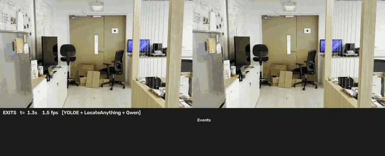
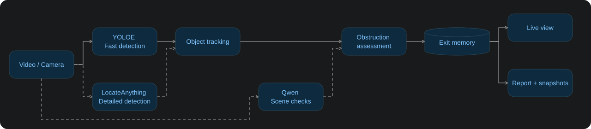

# Exit Obstruction Monitor

Tablet integration: see [Setup and run the demo](run_demo/running.md) for shared configuration, both backend machine setups, and the new External camera source.


Detects **exits** (doors, glass doors, doorways) in video from a handheld camera and
decides, in near real time, whether each one is **clear**, **partially obstructed** or
**obstructed**, and by what (boxes, chairs, trolleys, …).

Detection runs on a GPU server (2× RTX 4090) with three models working at different
speeds. The client — your laptop, or the server itself — plays the video, tracks
objects every frame and shows the result live.

| Model | Role | Runs |
|---|---|---|
| **YOLOE-11s** (Ultralytics, open-vocabulary) | Fast boxes + tracking | every frame (client GPU) |
| **LocateAnything-3B** (NVIDIA) | Accurate boxes, finds what YOLOE misses | ~1 per 1.5–2 s (server GPU 1) |
| **Qwen3-VL-4B-Instruct** (vLLM) | Scene understanding: is it an exit? on the floor? blocked? | only on events (server GPU 0) |



*`apps/exit_monitor.py` on `IMG_0450.MOV`: original (left), annotated (right), exit panel and
event log (bottom). The exit is confirmed by Qwen and turns **BLOCKED** (chairs, cardboard
boxes, bin); items on desks are dropped by the floor check.*

> The recorded test videos (`IMG_04xx.MOV`) stand in for the live camera. Any script
> also accepts a webcam index (`0`) or an RTSP URL, so switching to the real camera
> needs no code changes.

---

## Contents

1. [Architecture](#architecture)
2. [Why both YOLOE and LocateAnything?](#why-both-yoloe-and-locateanything)
3. [Repository layout](#repository-layout)
4. [Setup](#setup) — client, GPU server, `.env`
5. [Running](#running) — the fire safety inspection (everything else: [run_demo/running.md](run_demo/running.md))
6. [Backend API reference](#backend-api-reference) — for building your own app on the backend
7. [How decisions are made](#how-decisions-are-made)
8. [Measured performance](#measured-performance)
9. [Troubleshooting](#troubleshooting)
10. [Limitations, reproducibility, licences](#limitations)

---

## Architecture

`apps/exit_monitor.py` combines fast detection, object tracking and background model
checks to show whether each exit is clear or obstructed.



**Dashed arrows** show background model work. YOLOE and tracking run on the client;
LocateAnything and Qwen run on the GPU server without blocking the live view.
Qwen receives video images; tracking selects the crops and triggers scene checks.
Exit memory stabilizes each status before it is displayed and logged.

Simpler variants are also included (see [Other runners](run_demo/running.md#other-runners)).

---

## Why both YOLOE and LocateAnything?

They are complementary: **YOLOE is fast, LocateAnything is accurate.** Neither alone gives
a live view that is also correct.

| | YOLOE-11s | LocateAnything-3B |
|---|---|---|
| Time per frame | 45–75 ms on the Mac (expected ~10–20 ms on a 4090) | 1.5–1.9 s model time, 2–2.5 s round trip |
| Frames per second | ~13–20 | ~0.5 (one frame at a time) |
| Accuracy | weaker — misses doors, sometimes boxes pillars / fridges as doors | strong — finds chairs, stools, boxes and glass doors; labels are richer |
| Categories | fixed text prompts | prompts plus names supplied by Qwen (open-world) |

**Why the per-frame layer is YOLOE.**
1. *Tracking needs frequent detections.* A tracker links an object between frames by
   small movements. With detections ~2 s apart, a handheld camera moves too far in
   between: links break, objects lose their IDs and with them their stored Qwen
   verdicts (this broke an earlier position-based cache).
2. *New objects appear sooner.* YOLOE boxes something that enters the frame within a
   frame or two; LocateAnything alone takes up to ~2 s.
3. *Boxes stay accurate when the camera jerks.* Between LocateAnything results boxes
   move only by estimated camera motion, which drifts on fast pans and blur. YOLOE
   corrects them every frame.
4. *GPU headroom.* LocateAnything alone would keep a whole GPU busy; YOLOE uses a small
   fraction of one, leaving room for Qwen.

**Why LocateAnything is still needed.** YOLOE alone misses doors and objects, and its
false doors would raise false alarms. About once every 1.5–2 s LocateAnything's boxes
are mapped to the current frame and merged into the tracks: they fix labels, add
what YOLOE missed, and the tracker then follows them frame by frame. Names that Qwen
finds at the door are added to LocateAnything's categories, so objects outside the
fixed list can be found too.

**So:** YOLOE keeps the view *continuous*, LocateAnything keeps it *correct*, and Qwen
decides what it *means* (is it an exit, is it on the floor, is it blocked).

**A simpler option.** `--no-yoloe` runs LocateAnything + Qwen only
(`python run.py exits <video> --no-yoloe`). Results are more accurate per update
but ~1–2 s old, and IDs are less stable on fast camera moves. It is a good starting
point when a 2 s update interval is acceptable (a walkthrough inspection, not alarms)
or when you do not want to install YOLOE. Compare the two on the same video.

---

## Repository layout

```
run.py               the single entry point: python run.py <command> [options]
config.toml          settings for python run.py inspect (frame rates, resolution, models, rules, output)

apps/                the programs (run.py command in brackets)
  fire_safety_inspection.py  [inspect] exits + extinguishers on the same frames, one report
  exit_monitor.py      [exits] MAIN: YOLOE + LocateAnything + Qwen, exit memory, panel, report
  extinguisher_monitor.py  [extinguishers] YOLOE + Qwen reads the expiry / service date
  locate_live.py       [locate-live] LocateAnything (+ optional Qwen assist) live, position rule
  live_infer.py        [live] Qwen-only live (prompt → boxes + status); --delay buffered mode
  video_infer.py       [video] Qwen-only offline: process a recorded video, side-by-side output
  yoloe_infer.py       [yoloe] YOLOE-only live (local, no server)
  bench_latency.py     [bench] benchmark a VLM endpoint (TTFT, latency, throughput)
  locate_test.py       [locate-test] LocateAnything on sampled frames, annotated grid
  camera_check.py      [camera-check] camera / stream without models: fps, drops, latency clock

core/                shared library (no entry points)
  config.py          .env loading, VLM provider presets
  prompts.py         every prompt in one place
  parsing.py         VLM answer → detections (compact E/O lines or JSON) + sanity checks
  rules.py           geometric obstruction rule (clearance zone, occlusion, double doors)
  expiry.py          extinguisher dates: parse Qwen's DATE lines, due date, status
  depth_check.py     close-up "floor or furniture?" check with a position cache
  qwen_detect.py     one full-frame Qwen detection call
  qwen_assist.py     Qwen naming objects for LocateAnything + depth check
  labels.py          LocateAnything categories
  video_io.py        LiveSource (file paced as live; webcam / stream: newest frame, reconnect), camera motion
  drawing.py         boxes, banner, captions
  stream_view.py     MJPEG browser view (--stream)
engines/
  qwen_engine.py     OpenAI-compatible VLM client (vLLM, OpenRouter, DashScope, OpenAI)
  locate_engine.py   LocateAnything server client + answer parser
run_demo/            venue demo: run_windows.cmd + run_wsl.sh, README.md (one page), running.md
server/              GPU-server scripts: start_all.sh / status.sh / stop_all.sh, setup, serve
tests/test_core.py   offline tests for parsing / rules / LocateAnything output / live input
backend/             FastAPI service: live mode (frames in, boxes out), sessions, token auth
frontend/            web app (index.html, style.css, app.js) — talks to backend/
```

Outputs go to `results/` (git-ignored); model weights to `models/` (git-ignored).

---

## Setup

### 1. Client (any laptop / desktop)

Needed only for the command-line runners; the web app needs nothing but Python 3 to
host it (`bash frontend/serve.sh`). Tested with Python 3.14 on macOS (Apple Silicon;
YOLOE runs on the MPS GPU).

```bash
cd htx_demo
python3 -m venv .venv
.venv/bin/pip install -r requirements.txt
cp .env.sample .env          # then fill in the server addresses
.venv/bin/python tests/test_core.py    # offline sanity check: should print 17/17 passed
```

The first YOLOE run downloads `yoloe-11s-seg.pt` and the MobileCLIP text encoder
(~630 MB) into `models/`.

### 2. GPU server (Linux, NVIDIA driver)

Clone the repository on the server (and `git pull` there to pick up later changes):

```bash
git clone <repo-url> ~/qwe
cd ~/qwe
# later, after pushing changes from your computer:
git pull
```

The repo contains code only. Test videos, model weights and `.env` are git-ignored, so
copy a video over once (`scp IMG_0451.MOV <user>@<server>:~/qwe/`) — the weights
download automatically on first use.

**Quick start — one command** (recommended):

```bash
cd ~/qwe
bash server/start_all.sh          # QWEN_MODEL=8b-fp8 bash server/start_all.sh for another model
```

It does everything a new user would otherwise do by hand:
- creates the three Python environments on first run (~20–30 min: PyTorch + model
  weights) and installs anything missing later — broken envs are moved aside and rebuilt;
- starts Qwen, LocateAnything and the backend, each in a tmux session (`qwen`, `locate`,
  `backend`) — or as background processes if tmux is not installed — logging to `logs/`;
- creates a backend token in `.env` if there is none;
- waits until all three answer and prints the **backend port and token**. The backend
  only hosts the API; enter `http://<server-ip>:<port>` and the token in the web app,
  which is hosted separately (see *Backend + web app*).

Services that are already running are left alone, so it is safe to run again.

```bash
bash server/status.sh             # what is up, ports, GPU memory
bash server/stop_all.sh           # stop everything   (or: stop_all.sh backend)
tmux attach -t backend            # watch a service (Ctrl+B then D to leave)
```

**Single 8 GB GPU (e.g. an RTX 4060 laptop running everything itself).** LocateAnything-3B
(~7.7 GB of weights) and Qwen-4B (~8.9 GB) don't fit, so `start_all.sh` can't be used.
Serve Qwen3-VL-2B alone, sized to leave room for YOLOE, and run the monitors on the same
machine with `QWEN_URL=http://localhost:8000/v1` and no `LOCATE_URL`:

```bash
bash server/start_laptop.sh       # Qwen3-VL-2B in tmux 'qwen' on :8000; start before the monitors
```

The sections below are the same steps done manually.

Each model gets its **own Python environment** (their pinned packages conflict).
Start servers inside **tmux** so they survive logging out
(`Ctrl+B` then `D` to detach, `tmux attach -t <name>` to look again).

**Qwen (vLLM, OpenAI-compatible API)**

```bash
cd ~/qwe
bash server/setup_vllm.sh                 # once: ~/qwen-vllm/.venv with vllm==0.31.0
tmux new -s qwen
bash server/serve_qwen.sh 4b              # Qwen/Qwen3-VL-4B-Instruct on port 8000+ (first free)
```

`serve_qwen.sh` also accepts `2b`, `8b-fp8`, `8b`. It picks the first free port from
8000 upward, lowers `gpu_memory_utilization` to what is free on a shared GPU, and
disables the FlashInfer sampler (see [Troubleshooting](#troubleshooting)).
Choose the GPU with `CUDA_VISIBLE_DEVICES=1 bash server/serve_qwen.sh 4b`.

**LocateAnything-3B (transformers, small FastAPI server)**

```bash
bash server/setup_locate.sh               # once: ~/locate-anything/.venv (Python 3.11) + weights
tmux new -s locate
bash server/serve_locate.sh               # GPU 1 by default, port 8020+ (first free)
```

Endpoints: `GET /health`, `POST /detect {image, categories, mode}`,
`POST /ground {image, phrase}`. Boxes come back on a 0–1000 scale.

**Backend for the web app** — see [Backend + web app](run_demo/running.md#backend--web-app-backend-frontend):
`BACKEND_TOKEN=<secret> bash server/run_backend.sh` (in tmux, after `setup_monitor.sh`).

**Optional — run the monitor on the server too**

```bash
bash server/setup_monitor.sh              # once: ~/exit-monitor/.venv (torch, ultralytics, …)
bash server/run_monitor.sh IMG_0451.MOV   # finds both servers, loops the video,
                                          # browser view on http://<server>:8090
```

### 3. `.env`

All scripts load `.env` from the project root. The important entries:

```bash
LOCATE_URL=http://<server-ip>:8020        # LocateAnything
QWEN_URL=http://<server-ip>:8010/v1       # Qwen vLLM (port printed by serve_qwen.sh)
LOCAL_VLM_URL=http://<server-ip>:8010/v1  # same server, for --provider local
LOCAL_VLM_MODEL=Qwen/Qwen3-VL-4B-Instruct
OPENROUTER_API_KEY=...                    # only for the hosted-API option
```

Check that both servers answer before running:

```bash
curl http://<server-ip>:8010/v1/models
curl http://<server-ip>:8020/health
```

If the ports are not reachable from the client, tunnel them:
`ssh -L 8010:localhost:8010 -L 8020:localhost:8020 <user>@<server>` and use `localhost`.

---

## Running

Every program starts from `run.py` in the project root (`python run.py` lists them). This
section covers the main one, the **fire safety inspection**, and its settings.
**[run_demo/running.md](run_demo/running.md)** has the rest:

- what runs where: the backend, the tablet app, the tablet web page and the web app;
- running the demo at a venue, step by step (camera, laptop, tablet); the one-page
  version and the two start scripts are in [run_demo/](run_demo/README.md);
- the backend on a GPU server, and the backend's settings;
- one-time setup for the laptop, the tablet app and the camera;
- each monitor on its own, the backend and web app, the tablet web page, the simpler
  runners, the tools and the tests.

### Fire safety inspection: `python run.py inspect`

The inspection runs the exit monitor and the extinguisher monitor on the same frames,
from one camera or video. Each frame goes through both. They share one view, one event
log and one report.

**1. Start Qwen.** On the 8 GB laptop, do this once per session; it takes about a minute:

```bash
bash server/start_laptop.sh       # serves [models] qwen_model from config.toml (2b); prints QWEN_URL
```

`QWEN_URL` in `.env` must match the printed URL (`http://localhost:8000/v1`). On the GPU
server, `bash server/start_all.sh` starts Qwen-4B and LocateAnything instead (see
[Setup](#setup)); set `qwen_model = "4b"` there.

**2. Run it:**

```bash
python run.py inspect IMG_0451.MOV                          # a video, played as if live
python run.py inspect rtsp://<windows-host>:8554/live/x2    # the Pocket 3 via MediaMTX
python run.py inspect 0                                     # a USB webcam
python run.py inspect IMG_0451.MOV --save results/inspection.mp4 --no-display
python run.py inspect IMG_0451.MOV --process-fps 10 --proc-width 640
python run.py inspect IMG_0451.MOV --set exits.fps=5 --set extinguishers.today=2026-12-01
python run.py inspect IMG_0451.MOV --only extinguishers --stream     # browser view on :8090
python run.py inspect IMG_0451.MOV --yoloe 11l --qwen 2b-fp8         # other models
python run.py inspect --list-models
```

The window shows the original next to the annotated frame (both overlays), then the exit
panel and the extinguisher panel. Each panel header names the models in use, for example
`[YOLOE-11s + Qwen3-VL-2B]`. Keys: `q` or `Esc` quits, `space` pauses. Camera setup
(MediaMTX, DJI Mimo, WSL networking) is in [docs/live-camera.md](docs/live-camera.md).

#### Settings: `config.toml`

Every setting is commented in the file. Settings left out use their defaults.

| Section | What it sets |
|---|---|
| `[input]` | `source`, `loop`, `camera_size` (asked of a webcam), `stream_timeout` |
| `[processing]` | `process_fps` (see below) and `proc_width`, the processing width for tracking and drawing |
| `[models]` | YOLOE and Qwen model (see [Choosing models](#choosing-models)); Qwen and LocateAnything on/off and their URLs (default: `.env`) |
| `[exits]`, `[extinguishers]` | `enabled`; `fps` (see below); `imgsz`, the YOLOE input size; plus any option of that monitor, named as in its `--help` with `-` → `_` (`hold`, `min_px`, `soon_days`, `today`, …) |
| `[output]` | window, `show_original`, `view_width`, `save`, `stream`, snapshots, per-frame log, `out_dir` |

**Two frame rates.** `[processing] process_fps` sets how many frames per second the whole
loop takes from the source. The window, stream and saved video update at that rate, and
no task sees the frames in between. `[exits] fps` and `[extinguishers] fps` cap one task
within those frames. On a frame the task skips, the frame is still shown and the other
task still runs, and the skipped task's boxes stay where they were. For example,
`process_fps = 20` with `extinguishers.fps = 5` updates the view 20 times a second and
checks exits on every frame, but extinguishers on only 5 of them. `0` means no cap.

The command line wins over the file:

| Option | Sets |
|---|---|
| `source` | `[input] source` |
| `--process-fps N`, `--proc-width PX` | `[processing]` |
| `--yoloe NAME`, `--qwen NAME` | `[models] yoloe_model`, `qwen_model` |
| `--only exits` / `--only extinguishers` | turns the other task off |
| `--save FILE`, `--stream [PORT]`, `--no-display`, `--quiet`, `--loop` | `[output]` / `[input]` |
| `--set SECTION.KEY=VALUE` | anything else (repeatable) |
| `--config FILE` | another settings file |
| `--list-models` | prints the model choices and exits |

Unknown settings and wrong types stop the run with a list of the valid names.

#### Choosing models

Choosing a model is optional: by default the inspection uses YOLOE-11s and
Qwen3-VL-2B-Instruct, the models this laptop runs now. To test others, set
`yoloe_model` and `qwen_model` in `config.toml`, or pass `--yoloe` and `--qwen`.
`python run.py inspect --list-models` shows the choices, which YOLOE weights are already
downloaded, and which Qwen model the server serves now.

| YOLOE (`yoloe_model`, `--yoloe`) | |
|---|---|
| `11s` (default), `11m`, `11l` | YOLOE-11 |
| `v8s`, `v8m`, `v8l` | YOLOE-v8 |
| `26n`, `26s`, `26m`, `26l`, `26x` | YOLOE-26 |

Within a family, a bigger model (n < s < m < l < x) is slower and finds more. The first
run with a model downloads it into `models/`. The first YOLOE-26 run also downloads its
text encoder (`mobileclip2_b.ts`, 240 MB). Both tasks use the same YOLOE model, each as
its own instance.

| Qwen3-VL (`qwen_model`, `--qwen`) | Hugging Face repo | Weights | 8 GB laptop |
|---|---|---|---|
| `2b` (default) | `Qwen/Qwen3-VL-2B-Instruct` | 4.3 GB | yes |
| `2b-fp8` | `Qwen/Qwen3-VL-2B-Instruct-FP8` | 3.5 GB | yes |
| `4b` | `Qwen/Qwen3-VL-4B-Instruct` | 8.9 GB | no |
| `4b-fp8` | `Qwen/Qwen3-VL-4B-Instruct-FP8` | 6.0 GB | no |
| `8b` | `Qwen/Qwen3-VL-8B-Instruct` | 17.5 GB | no |
| `8b-fp8` | `Qwen/Qwen3-VL-8B-Instruct-FP8` | 10.6 GB | no |

Repo names such as `qwen3-vl-4b-instruct` work too, and `qwen_model = ""` uses whatever
the server serves. The list has Instruct models only. The Thinking variants reason at
length before answering, which would cut off the one-word answers the monitors ask for.

The Qwen server serves one model at a time, so changing the Qwen model means restarting
the server:

```bash
bash server/start_laptop.sh 2b-fp8      # stops the running model, starts this one (~1 min;
                                        # the first start also downloads it)
python run.py inspect IMG_0451.MOV --qwen 2b-fp8
```

The inspection checks that the server serves the chosen model and, if not, prints the
command to switch it. `start_laptop.sh` refuses models that don't fit in its share of the
GPU before it stops the running one. On this laptop that leaves the two 2B models. For
4B and 8B, run `bash server/serve_qwen.sh 4b` on the GPU server and point `qwen_url` (or
`QWEN_URL`) at it.

#### Output

The log prints one line per frame, with the `EXITS …` and `EXT …` parts separated by
`||`, plus events. Reports go to `results/fire_safety_<video>/`:

- `report.json`: summary counts, all exits, all extinguishers, one event log tagged by
  task, the models and the settings used;
- `exits/` and `extinguishers/`: each task's own report and snapshots.

Photos still go through `python run.py extinguishers` ([run_demo/running.md](run_demo/running.md)).

There are two YOLOE models rather than one with both prompt lists. YOLOE gives each box
its single best-scoring prompt, so the extinguisher decoys ("red bag", "red trash can")
would take obstacle boxes away from the exit rule.

Measured on the dev laptop (RTX 4060 8 GB, YOLOE-11s + Qwen3-VL-2B, 800×448 test clip):
about 42 ms per frame with both tasks, against about 29 ms for exits alone. That is about
23 fps, so a 25–30 fps camera drops some frames. GPU memory peaked at 7.2 of 8 GB.

---

## Backend API reference

The backend's API (REST and WebSocket: live mode, server-video sessions, every message
format) is documented in **[docs/android-api.md](docs/android-api.md)**, written for the
Android tablet app. The web app (`frontend/app.js`) is a client of the same API.

---

## How decisions are made

**Exits.** Doors come from YOLOE / LocateAnything (`door`, `glass door`, `doorway`).
Side-by-side leaves are merged into one door; a door with an EXIT sign just above it is
labelled `EXIT`. Qwen confirms each new door is a way out (rejects TVs, cupboards,
glass partitions) before any status is shown.

**Obstructions** (`core/rules.py`). For each door, a *clearance zone* covers the lower
part of the door and the floor in front of it (a bit wider than the door). An object
obstructs the door if
- it stands on the floor inside that zone (its bottom edge is in the zone), or
- it hides the bottom edge of the door (occlusion rule — needed because detectors box
  only the visible part of a door partly hidden by boxes).

Status from how much of the door width the obstructions cover:
≥ 60 % → **obstructed**, any → **partially obstructed**, none → **clear**.
Qwen's verdict (C/P/B on a close-up of the door), when recent, is combined with the
rule — the more severe one wins.

**Depth check.** A 2D image can't tell a plant on a desk in front of the door from a
plant at the door. Each new obstruction gets a close-up of its base and the question
"floor or raised surface?" (`DEPTH_PROMPT` in `core/prompts.py`); objects on raised
surfaces are ignored for as long as they are tracked.

**Prompts.** All prompts live in `core/prompts.py`. The full-frame detection prompt
asks for a compact line format (`E P x1 y1 x2 y2`, `O 1 floor chair x1 y1 x2 y2`) —
about 3× shorter than JSON, which matters because answer length dominates latency on a
self-hosted GPU.

---

## Measured performance

Measured during development (RTX 4090 server shared with another user; Mac = Apple
Silicon client over the LAN). Treat as indicative.

| Component | Measured |
|---|---|
| Qwen3-VL-4B, full-frame detection (compact format) | 0.8–1.3 s per call |
| Qwen3-VL-4B, short answers (name objects / floor check / yes-no) | 0.2–0.7 s |
| Qwen3-VL-8B (bf16), full-frame detection | 2–3 s (~44 tokens/s) |
| Qwen3-VL-8B via OpenRouter | 2.3–4 s, occasional 10 s+ outliers |
| LocateAnything-3B, `hybrid`, 960 px | 1.5–1.9 s model time, 2–2.5 s round trip |
| YOLOE-11s on the Mac (MPS) | 45–75 ms per frame |
| `apps/exit_monitor.py` fast loop on the Mac | ~75 ms per frame (~13 fps) |

YOLOE on the 4090 (`server/run_monitor.sh`) is expected to be several times faster but
has not been benchmarked yet.

---

## Troubleshooting

| Symptom | Cause / fix |
|---|---|
| `Connection refused` on 8010 / 8020 | Server not running (often stopped when its SSH session closed) → start it in **tmux**. `run_monitor.sh` prints the exact command. |
| `Address already in use` | Port taken on the shared server → scripts move to the next free port automatically; read the printed URL. |
| `Free memory on device … less than desired GPU memory utilization` | GPU shared → `serve_qwen.sh` lowers it automatically; or `GPU_UTIL=0.5`, or use the other GPU with `CUDA_VISIBLE_DEVICES=1`. |
| `nvcc fatal: Unknown option '--compress-mode=size'` | FlashInfer JIT with an old system CUDA → `serve_qwen.sh` sets `VLLM_USE_FLASHINFER_SAMPLER=0`. |
| All results `exits=0` with Qwen-4B | The model answered in its own JSON layout → handled by `core/parsing.py`; make sure the client code is up to date. |
| `Qwen assist: OFF` | `--qwen-url` not given and `QWEN_URL` not in `.env`. |
| Web app: video doesn't play | Browser can't decode the file (often HEVC outside macOS) → `ffmpeg -i in.MOV -c:v libx264 -pix_fmt yuv420p out.mp4` |
| Web app: "Qwen down — skipped" | Live mode carries on without that model; start it (`bash server/start_all.sh`) and press Start detection again. |
| Browser view not reachable | `ssh -L 8090:localhost:8090 <user>@<server>` → `http://localhost:8090`. |
| `No frames from rtsp://… after 30 s`, frequent `stream lost — reconnecting` | Live camera problems (MediaMTX, Wi-Fi, firewall, WSL2) → [docs/live-camera.md](docs/live-camera.md#7-troubleshooting). |
| LocateAnything setup fails at the PyTorch step | `TORCH_INDEX=https://download.pytorch.org/whl/cu121 bash server/setup_locate.sh` |

---

## Limitations

- **Depth from 2D.** The floor-vs-raised check is a VLM judgement on a crop; it can
  drop a real chair standing next to a cabinet, or keep a desk item. A depth model or
  RGB-D camera would make this geometric.
- **Fixed furniture.** Cabinets/desks near a door may be labelled `table` and counted
  as obstructions.
- **Double doors** are sometimes tracked as one leaf.
- **Handheld motion.** Fast pans can briefly mis-place boxes until the next detection.
- **Status lag.** A change is shown ~1.5 s (hold) after it is detected; LocateAnything
  results are 1.5–2.5 s old when they arrive (boxes are motion-compensated).

## Reproducibility

- Client packages are pinned in `requirements.txt`; server environments are created by
  `server/setup_*.sh` (vLLM 0.31.0, transformers 4.57.1 for LocateAnything,
  ultralytics 8.4.176).
- Models: `Qwen/Qwen3-VL-4B-Instruct` (also tested: 2B, 8B, 8B-FP8),
  `nvidia/LocateAnything-3B`, `yoloe-11s-seg.pt` — downloaded automatically.
- Qwen calls use `temperature=0`, so the same frame gives the same answer.
  LocateAnything uses the sampling settings from its model card (temperature 0.7), so
  its boxes can vary slightly between runs.
- Live runs pace the video to wall-clock time and drop frames when processing is slow,
  so frame-level results depend on hardware speed; `apps/video_infer.py` (offline) does not
  drop frames.

## Licences

- **LocateAnything-3B** – NVIDIA licence, **non-commercial research use only**.
- **YOLOE / Ultralytics** – AGPL-3.0 (commercial use needs an Ultralytics licence).
- **Qwen3-VL** – Apache-2.0.

Fine for research; check before any product use.
