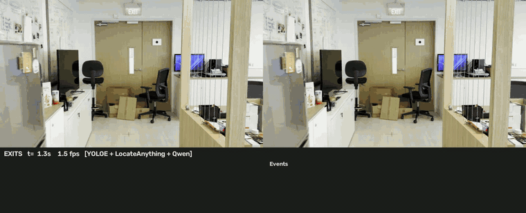
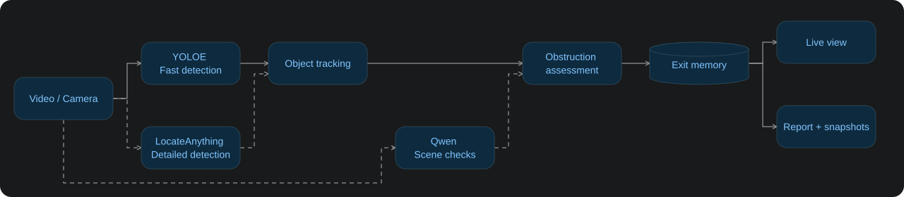

# Exit Obstruction Monitor

Detects **exits** (doors, glass doors, doorways) in video from a handheld camera and
decides, in near real time, whether each one is **clear**, **partially obstructed** or
**obstructed**, and by what (boxes, chairs, trolleys, …).

Detection runs on a GPU server (2× RTX 4090) with three models working at different
speeds. The client — your laptop, or the server itself — plays the video, tracks
objects every frame and shows the result live.

| Model | Role | Runs |
|---|---|---|
| **YOLOE-11s** (Ultralytics, open-vocabulary) | Fast boxes + tracking | every frame (client GPU) |
| **LocateAnything-3B** (NVIDIA) | Accurate boxes, finds what YOLOE misses | ~1 per 1.5–2 s (server GPU 1) |
| **Qwen3-VL-4B-Instruct** (vLLM) | Scene understanding: is it an exit? on the floor? blocked? | only on events (server GPU 0) |



*`exit_monitor.py` on `IMG_0450.MOV`: original (left), annotated (right), exit panel and
event log (bottom). The exit is confirmed by Qwen and turns **BLOCKED** (chairs, cardboard
boxes, bin); items on desks are dropped by the floor check.*

> The recorded test videos (`IMG_04xx.MOV`) stand in for the live camera. Any script
> also accepts a webcam index (`0`) or an RTSP URL, so switching to the real camera
> needs no code changes.

---

## Contents

1. [Architecture](#architecture)
2. [Why both YOLOE and LocateAnything?](#why-both-yoloe-and-locateanything)
3. [Repository layout](#repository-layout)
4. [Setup](#setup) — client, GPU server, `.env`
5. [Running](#running) — the main monitor and the other runners
6. [How decisions are made](#how-decisions-are-made)
7. [Measured performance](#measured-performance)
8. [Troubleshooting](#troubleshooting)
9. [Limitations, reproducibility, licences](#limitations)

---

## Architecture

`exit_monitor.py` combines fast detection, object tracking and background model
checks to show whether each exit is clear or obstructed.



**Dashed arrows** show background model work. YOLOE and tracking run on the client;
LocateAnything and Qwen run on the GPU server without blocking the live view.
Qwen receives video images; tracking selects the crops and triggers scene checks.
Exit memory stabilizes each status before it is displayed and logged.

Simpler variants are also included (see [Other runners](#other-runners)).

---

## Why both YOLOE and LocateAnything?

They are complementary: **YOLOE is fast, LocateAnything is accurate.** Neither alone gives
a live view that is also correct.

| | YOLOE-11s | LocateAnything-3B |
|---|---|---|
| Time per frame | 45–75 ms on the Mac (expected ~10–20 ms on a 4090) | 1.5–1.9 s model time, 2–2.5 s round trip |
| Frames per second | ~13–20 | ~0.5 (one frame at a time) |
| Accuracy | weaker — misses doors, sometimes boxes pillars / fridges as doors | strong — finds chairs, stools, boxes and glass doors; labels are richer |
| Categories | fixed text prompts | prompts plus names supplied by Qwen (open-world) |

**Why the per-frame layer is YOLOE.**
1. *Tracking needs frequent detections.* A tracker links an object between frames by
   small movements. With detections ~2 s apart, a handheld camera moves too far in
   between: links break, objects lose their IDs and with them their stored Qwen
   verdicts (this broke an earlier position-based cache).
2. *New objects appear sooner.* YOLOE boxes something that enters the frame within a
   frame or two; LocateAnything alone takes up to ~2 s.
3. *Boxes stay accurate when the camera jerks.* Between LocateAnything results boxes
   move only by estimated camera motion, which drifts on fast pans and blur. YOLOE
   corrects them every frame.
4. *GPU headroom.* LocateAnything alone would keep a whole GPU busy; YOLOE uses a small
   fraction of one, leaving room for Qwen.

**Why LocateAnything is still needed.** YOLOE alone misses doors and objects, and its
false doors would raise false alarms. About once every 1.5–2 s LocateAnything's boxes
are mapped to the current frame and merged into the tracks: they fix labels, add
what YOLOE missed, and the tracker then follows them frame by frame. Names that Qwen
finds at the door are added to LocateAnything's categories, so objects outside the
fixed list can be found too.

**So:** YOLOE keeps the view *continuous*, LocateAnything keeps it *correct*, and Qwen
decides what it *means* (is it an exit, is it on the floor, is it blocked).

**A simpler option.** `--no-yoloe` runs LocateAnything + Qwen only
(`python exit_monitor.py <video> --no-yoloe`). Results are more accurate per update
but ~1–2 s old, and IDs are less stable on fast camera moves. It is a good starting
point when a 2 s update interval is acceptable (a walkthrough inspection, not alarms)
or when you do not want to install YOLOE. Compare the two on the same video.

---

## Repository layout

```
exit_monitor.py      MAIN: YOLOE + LocateAnything + Qwen, exit memory, panel, report
locate_live.py       LocateAnything (+ optional Qwen assist) live, position rule
live_infer.py        Qwen-only live (prompt → boxes + status); --delay buffered mode
video_infer.py       Qwen-only offline: process a recorded video, side-by-side output
yoloe_infer.py       YOLOE-only live (local, no server)
bench_latency.py     Benchmark a VLM endpoint (TTFT, latency, throughput)
locate_test.py       Run LocateAnything on sampled frames, save an annotated grid

core/                shared library (no entry points)
  config.py          .env loading, VLM provider presets
  prompts.py         every prompt in one place
  parsing.py         VLM answer → detections (compact E/O lines or JSON) + sanity checks
  rules.py           geometric obstruction rule (clearance zone, occlusion, double doors)
  depth_check.py     close-up "floor or furniture?" check with a position cache
  qwen_detect.py     one full-frame Qwen detection call
  qwen_assist.py     Qwen naming objects for LocateAnything + depth check
  labels.py          LocateAnything categories
  video_io.py        LiveSource (file paced as live / webcam / RTSP), camera motion
  drawing.py         boxes, banner, captions
  stream_view.py     MJPEG browser view (--stream)
engines/
  qwen_engine.py     OpenAI-compatible VLM client (vLLM, OpenRouter, DashScope, OpenAI)
  locate_engine.py   LocateAnything server client + answer parser
server/              GPU-server scripts: start_all.sh / status.sh / stop_all.sh, setup, serve
tests/test_core.py   offline tests for parsing / rules / LocateAnything output
backend/             FastAPI service: live mode (frames in, boxes out), sessions, token auth
frontend/            web app (index.html, style.css, app.js) — talks to backend/
```

Outputs go to `results/` (git-ignored); model weights to `models/` (git-ignored).

---

## Setup

### 1. Client (any laptop / desktop)

Needed only for the command-line runners; the web app needs nothing but Python 3 to
host it (`bash frontend/serve.sh`). Tested with Python 3.14 on macOS (Apple Silicon;
YOLOE runs on the MPS GPU).

```bash
cd htx_demo
python3 -m venv .venv
.venv/bin/pip install -r requirements.txt
cp .env.sample .env          # then fill in the server addresses
.venv/bin/python tests/test_core.py    # offline sanity check: should print 11/11 passed
```

The first YOLOE run downloads `yoloe-11s-seg.pt` and the MobileCLIP text encoder
(~630 MB) into `models/`.

### 2. GPU server (Linux, NVIDIA driver)

Clone the repository on the server (and `git pull` there to pick up later changes):

```bash
git clone <repo-url> ~/qwe
cd ~/qwe
# later, after pushing changes from your computer:
git pull
```

The repo contains code only. Test videos, model weights and `.env` are git-ignored, so
copy a video over once (`scp IMG_0451.MOV <user>@<server>:~/qwe/`) — the weights
download automatically on first use.

**Quick start — one command** (recommended):

```bash
cd ~/qwe
bash server/start_all.sh          # QWEN_MODEL=8b-fp8 bash server/start_all.sh for another model
```

It does everything a new user would otherwise do by hand:
- creates the three Python environments on first run (~20–30 min: PyTorch + model
  weights) and installs anything missing later — broken envs are moved aside and rebuilt;
- starts Qwen, LocateAnything and the backend, each in a tmux session (`qwen`, `locate`,
  `backend`) — or as background processes if tmux is not installed — logging to `logs/`;
- creates a backend token in `.env` if there is none;
- waits until all three answer and prints the **backend port and token**. The backend
  only hosts the API; enter `http://<server-ip>:<port>` and the token in the web app,
  which is hosted separately (see *Backend + web app*).

Services that are already running are left alone, so it is safe to run again.

```bash
bash server/status.sh             # what is up, ports, GPU memory
bash server/stop_all.sh           # stop everything   (or: stop_all.sh backend)
tmux attach -t backend            # watch a service (Ctrl+B then D to leave)
```

The sections below are the same steps done manually.

Each model gets its **own Python environment** (their pinned packages conflict).
Start servers inside **tmux** so they survive logging out
(`Ctrl+B` then `D` to detach, `tmux attach -t <name>` to look again).

**Qwen (vLLM, OpenAI-compatible API)**

```bash
cd ~/qwe
bash server/setup_vllm.sh                 # once: ~/qwen-vllm/.venv with vllm==0.31.0
tmux new -s qwen
bash server/serve_qwen.sh 4b              # Qwen/Qwen3-VL-4B-Instruct on port 8000+ (first free)
```

`serve_qwen.sh` also accepts `2b`, `8b-fp8`, `8b`. It picks the first free port from
8000 upward, lowers `gpu_memory_utilization` to what is free on a shared GPU, and
disables the FlashInfer sampler (see [Troubleshooting](#troubleshooting)).
Choose the GPU with `CUDA_VISIBLE_DEVICES=1 bash server/serve_qwen.sh 4b`.

**LocateAnything-3B (transformers, small FastAPI server)**

```bash
bash server/setup_locate.sh               # once: ~/locate-anything/.venv (Python 3.11) + weights
tmux new -s locate
bash server/serve_locate.sh               # GPU 1 by default, port 8020+ (first free)
```

Endpoints: `GET /health`, `POST /detect {image, categories, mode}`,
`POST /ground {image, phrase}`. Boxes come back on a 0–1000 scale.

**Backend for the web app** — see [Backend + web app](#backend--web-app-backend-frontend):
`BACKEND_TOKEN=<secret> bash server/run_backend.sh` (in tmux, after `setup_monitor.sh`).

**Optional — run the monitor on the server too**

```bash
bash server/setup_monitor.sh              # once: ~/exit-monitor/.venv (torch, ultralytics, …)
bash server/run_monitor.sh IMG_0451.MOV   # finds both servers, loops the video,
                                          # browser view on http://<server>:8090
```

### 3. `.env`

All scripts load `.env` from the project root. The important entries:

```bash
LOCATE_URL=http://<server-ip>:8020        # LocateAnything
QWEN_URL=http://<server-ip>:8010/v1       # Qwen vLLM (port printed by serve_qwen.sh)
LOCAL_VLM_URL=http://<server-ip>:8010/v1  # same server, for --provider local
LOCAL_VLM_MODEL=Qwen/Qwen3-VL-4B-Instruct
OPENROUTER_API_KEY=...                    # only for the hosted-API option
```

Check that both servers answer before running:

```bash
curl http://<server-ip>:8010/v1/models
curl http://<server-ip>:8020/health
```

If the ports are not reachable from the client, tunnel them:
`ssh -L 8010:localhost:8010 -L 8020:localhost:8020 <user>@<server>` and use `localhost`.

---

## Running

### Main: `exit_monitor.py`

```bash
.venv/bin/python exit_monitor.py IMG_0451.MOV            # URLs from .env
.venv/bin/python exit_monitor.py IMG_0451.MOV --loop --save results/run.mp4
.venv/bin/python exit_monitor.py IMG_0451.MOV --no-yoloe # LocateAnything + Qwen only
.venv/bin/python exit_monitor.py IMG_0451.MOV --no-display --stream   # browser :8090
```

Window: original | annotated video, and a panel listing each exit (status, for how
long, blockers) plus the latest events. Keys: `q`/`Esc` quit, `space` pause.

| Option | Default | Meaning |
|---|---|---|
| `--locate-url`, `--qwen-url` | from `.env` | model servers (either can be omitted) |
| `--no-yoloe` | off | no per-frame detector; tracks come from LocateAnything only |
| `--la-interval` | 1.0 s | minimum gap between LocateAnything calls |
| `--name-every` | 3.0 s | how often Qwen names objects at the door |
| `--hold` | 1.5 s | a new status must hold this long before it is shown |
| `--recheck` | 8.0 s | re-ask Qwen for a verdict at least this often per exit |
| `--verdict-ttl` | 6.0 s | how long a Qwen verdict counts |
| `--confirm-timeout` | 6.0 s | show a door's status without Qwen's exit confirmation after this |
| `--proc-width` | 960 | processing width in px |
| `--quiet` | off | no per-frame log line |
| `--stream [PORT]`, `--save FILE`, `--loop`, `--no-display`, `--out-dir` | | output options |

**Terminal log** – one line per processed frame, plus events:

```
f   98 t=  3.27s   76ms | YOLOE  8 det  54ms | LA: result back: 21 boxes (2.2s); sent frame; merged 21 boxes | Qwen: -> depth#24 -> verdict#9 | tracks: 2 door, 16 obstacle
f  137 t=  4.57s   73ms | YOLOE  7 det  69ms | LA: - | Qwen: <- confirm#9=yes | tracks: 3 door, 12 obstacle
[   4.8s] EXIT #9: CHECKING -> BLOCKED (chair, stool, cardboard box x4)
```

`->` = a Qwen job started (`confirm` = is it an exit, `depth` = floor or raised,
`verdict` = C/P/B), `<-` = its answer. LocateAnything runs back to back: it sends the
newest frame as soon as the previous answer is back (and `--la-interval` has passed).

**Output** – `results/exit_monitor_<video>/report.json` (status history, blockers and a
snapshot per exit, all events) and `exit<id>_<time>_<status>.jpg` snapshots.

### Backend + web app (`backend/`, `frontend/`)

The detection pipeline runs as a **FastAPI service on the GPU server** (API only). The
web app is hosted **separately**, on whatever machine you like, and connects to the
backend with its address and token. The detection code is the same as `exit_monitor.py`.

**Live mode (default).** The video plays **in the browser**, from a local file or the
camera. The web app sends small JPEG frames (960 px wide) to the server over one
WebSocket; the server sends back **only JSON**: exit and obstruction boxes, statuses and
events. The browser draws the boxes over its own video, so playback never waits for the
network. It keeps one frame in flight at a time (at most 15 per second), so frames never
queue up. On the same network, expect a round trip of about 50–70 ms, or about 13–15
results per second.

```
Browser:     video ─► JPEG frames ──WS /api/live──►  GPU server: backend (FastAPI, :8100)
             boxes ◄── JSON (boxes, statuses) ◄──     └─ YOLOE + LocateAnything + Qwen
```

**On the server:** run `bash server/start_all.sh`. It starts Qwen, LocateAnything and
the backend, and prints the backend port and token. To start only the backend, run
`bash server/run_backend.sh`.

**Host the web app** on any machine with Python 3 (it is static files only):

```bash
bash frontend/serve.sh                  # http://localhost:5173
# no bash (e.g. Windows): python -m http.server 5173 --bind localhost -d frontend
```

Open `http://localhost:5173`, enter the **Backend URL** (`http://<server-ip>:<port>`) and
the **Token**, then click **Connect**, then **Open video** (or **Camera**), then **Start detection**:

- **Status line:** which models are in use, results per second, round-trip time
  (and the server's share of it), exit statuses and the last event.
- **Down model servers:** a server that is down is skipped and reported, rather than
  failing the session.
- **New video:** opening another video resets the exit memory on the server.
- **Left side:** the original video, and the video with bounding boxes.
- **Right side:** the checklist, pop-up and chat are a *mockup only* for now. Live events
  already arrive (`onEvent` in `frontend/app.js`), ready to wire up.

Notes:

- **Playing `.MOV` files:** iPhone `.MOV` files (HEVC) play in Safari and Chrome on
  macOS; other browsers / systems may not. If a browser can't play a file, convert it first:
  `ffmpeg -i in.MOV -c:v libx264 -pix_fmt yuv420p out.mp4`.
- **Camera:** the browser allows camera access only on `https://` or `localhost`. Use
  the web app on `localhost` (`frontend/serve.sh` does by default), or serve it over https.
- **Unreachable port:** if the server port can't be reached from your computer, tunnel it with
  `ssh -L 8100:localhost:8100 <user>@<server>` and use `http://localhost:8100`.

**Server-video sessions (older mode).** In this mode the server reads a video from its
own disk and streams MJPEG frames back (`/api/sessions…` below). It is useful for
recording and reports, but it lags over a slow link.

Live frame message (a binary WebSocket message, little-endian): `uint32 seq`, then
`float64 video_time_s`, then the JPEG bytes. Box coordinates in the replies are
fractions of the frame, from 0 to 1.

| Endpoint | |
|---|---|
| `GET /api/health` | liveness, whether a token is required (no auth) |
| `GET /api/info` | model servers up/down, videos, sessions |
| `GET /api/videos` | videos a session can play (files in `BACKEND_VIDEO_DIR`) |
| `POST /api/sessions` | start `{source, loop, use_yoloe, use_locate, use_qwen, options}` |
| `GET /api/sessions`, `GET /api/sessions/{id}` | status + latest state (exits, blockers) |
| `DELETE /api/sessions/{id}` | stop (report is written) |
| `GET /api/sessions/{id}/stream/{original\|annotated\|combined}` | MJPEG streams |
| `WS /api/sessions/{id}/events` | live `event` / `state` / `end` messages |
| `WS /api/live` | **live mode**: `{type:"start"}` → `ready`; binary frame → `result` (exits, obstacles, events); `{type:"reset"}`, `{type:"stop"}` |
| `GET /api/sessions/{id}/report` | `report.json` after the session ends |
| `POST /api/sessions/{id}/command` | chat / commands — not implemented yet (501) |

Interactive API docs: `http://<server-ip>:8100/docs`. `source` is a video file name in
the server's video folder (default: the repo root) or an `rtsp://` URL.

| Setting (env / `.env` on the server) | Default | |
|---|---|---|
| `BACKEND_TOKEN` | *(none)* | shared secret: `Authorization: Bearer <token>` or `?token=` — **set it** |
| `BACKEND_CORS_ORIGINS` | `*` | origins allowed to call the API, e.g. `http://localhost:5173` |
| `BACKEND_VIDEO_DIR` | repo root | where session videos are read from |
| `BACKEND_MAX_SESSIONS` | `1` | concurrent sessions, live ones included (one GPU pipeline) |
| `LOCATE_URL`, `QWEN_URL` | from the port files | model servers (localhost on the server) |

`exit_monitor.py --stream` still works for quick checks: an all-in-one browser view
(`/stream`), plus `/stream/original`, `/stream/annotated` and `/state`.

### Other runners

| Script | What it does | Example |
|---|---|---|
| `locate_live.py` | LocateAnything every ~1.5–2 s + position rule; `--qwen-url` adds Qwen naming + depth check | `python locate_live.py IMG_0451.MOV --url http://<srv>:8020 --qwen-url http://<srv>:8010/v1` |
| `live_infer.py` | Qwen detects exits + obstructions from the prompt; results shown live, boxes motion-compensated | `python live_infer.py IMG_0451.MOV --provider local --interval 0.2 --workers 4` |
| `live_infer.py --delay N` | buffered: plays N s behind live so every frame has a fresh result | `python live_infer.py IMG_0451.MOV --provider local --delay 4` |
| `video_infer.py` | offline: parallel calls over a recorded video → side-by-side mp4 + JSON | `python video_infer.py IMG_0450.MOV --provider local --play` |
| `yoloe_infer.py` | YOLOE + position rule only, no server | `python yoloe_infer.py IMG_0450.MOV` |

`--provider` for the Qwen runners: `local` (your vLLM server, from `LOCAL_VLM_URL`),
`openrouter` (default, `qwen/qwen3-vl-8b-instruct`), `qwen` (DashScope), `openai`.
All live runners accept `--stream`, `--save`, `--loop`, `--no-display`.

### Tools

```bash
python bench_latency.py IMG_0450.MOV --provider local --sizes 448 640 --concurrency 1 4 8
python locate_test.py IMG_0450.MOV --url http://<srv>:8020 --mode fast
python tests/test_core.py
bash server/run_realtime_test.sh IMG_0450.MOV   # on the server: benchmark + live run + verdict
bash server/watch_live.sh IMG_0450.MOV          # on the server: live_infer → browser
```

---

## How decisions are made

**Exits.** Doors come from YOLOE / LocateAnything (`door`, `glass door`, `doorway`).
Side-by-side leaves are merged into one door; a door with an EXIT sign just above it is
labelled `EXIT`. Qwen confirms each new door is a way out (rejects TVs, cupboards,
glass partitions) before any status is shown.

**Obstructions** (`core/rules.py`). For each door, a *clearance zone* covers the lower
part of the door and the floor in front of it (a bit wider than the door). An object
obstructs the door if
- it stands on the floor inside that zone (its bottom edge is in the zone), or
- it hides the bottom edge of the door (occlusion rule — needed because detectors box
  only the visible part of a door partly hidden by boxes).

Status from how much of the door width the obstructions cover:
≥ 60 % → **obstructed**, any → **partially obstructed**, none → **clear**.
Qwen's verdict (C/P/B on a close-up of the door), when recent, is combined with the
rule — the more severe one wins.

**Depth check.** A 2D image can't tell a plant on a desk in front of the door from a
plant at the door. Each new obstruction gets a close-up of its base and the question
"floor or raised surface?" (`DEPTH_PROMPT` in `core/prompts.py`); objects on raised
surfaces are ignored for as long as they are tracked.

**Prompts.** All prompts live in `core/prompts.py`. The full-frame detection prompt
asks for a compact line format (`E P x1 y1 x2 y2`, `O 1 floor chair x1 y1 x2 y2`) —
about 3× shorter than JSON, which matters because answer length dominates latency on a
self-hosted GPU.

---

## Measured performance

Measured during development (RTX 4090 server shared with another user; Mac = Apple
Silicon client over the LAN). Treat as indicative.

| Component | Measured |
|---|---|
| Qwen3-VL-4B, full-frame detection (compact format) | 0.8–1.3 s per call |
| Qwen3-VL-4B, short answers (name objects / floor check / yes-no) | 0.2–0.7 s |
| Qwen3-VL-8B (bf16), full-frame detection | 2–3 s (~44 tokens/s) |
| Qwen3-VL-8B via OpenRouter | 2.3–4 s, occasional 10 s+ outliers |
| LocateAnything-3B, `hybrid`, 960 px | 1.5–1.9 s model time, 2–2.5 s round trip |
| YOLOE-11s on the Mac (MPS) | 45–75 ms per frame |
| `exit_monitor.py` fast loop on the Mac | ~75 ms per frame (~13 fps) |

YOLOE on the 4090 (`server/run_monitor.sh`) is expected to be several times faster but
has not been benchmarked yet.

---

## Troubleshooting

| Symptom | Cause / fix |
|---|---|
| `Connection refused` on 8010 / 8020 | Server not running (often stopped when its SSH session closed) → start it in **tmux**. `run_monitor.sh` prints the exact command. |
| `Address already in use` | Port taken on the shared server → scripts move to the next free port automatically; read the printed URL. |
| `Free memory on device … less than desired GPU memory utilization` | GPU shared → `serve_qwen.sh` lowers it automatically; or `GPU_UTIL=0.5`, or use the other GPU with `CUDA_VISIBLE_DEVICES=1`. |
| `nvcc fatal: Unknown option '--compress-mode=size'` | FlashInfer JIT with an old system CUDA → `serve_qwen.sh` sets `VLLM_USE_FLASHINFER_SAMPLER=0`. |
| All results `exits=0` with Qwen-4B | The model answered in its own JSON layout → handled by `core/parsing.py`; make sure the client code is up to date. |
| `Qwen assist: OFF` | `--qwen-url` not given and `QWEN_URL` not in `.env`. |
| Web app: video doesn't play | Browser can't decode the file (often HEVC outside macOS) → `ffmpeg -i in.MOV -c:v libx264 -pix_fmt yuv420p out.mp4` |
| Web app: "Qwen down — skipped" | Live mode carries on without that model; start it (`bash server/start_all.sh`) and press Start detection again. |
| Browser view not reachable | `ssh -L 8090:localhost:8090 <user>@<server>` → `http://localhost:8090`. |
| LocateAnything setup fails at the PyTorch step | `TORCH_INDEX=https://download.pytorch.org/whl/cu121 bash server/setup_locate.sh` |

---

## Limitations

- **Depth from 2D.** The floor-vs-raised check is a VLM judgement on a crop; it can
  drop a real chair standing next to a cabinet, or keep a desk item. A depth model or
  RGB-D camera would make this geometric.
- **Fixed furniture.** Cabinets/desks near a door may be labelled `table` and counted
  as obstructions.
- **Double doors** are sometimes tracked as one leaf.
- **Handheld motion.** Fast pans can briefly mis-place boxes until the next detection.
- **Status lag.** A change is shown ~1.5 s (hold) after it is detected; LocateAnything
  results are 1.5–2.5 s old when they arrive (boxes are motion-compensated).

## Reproducibility

- Client packages are pinned in `requirements.txt`; server environments are created by
  `server/setup_*.sh` (vLLM 0.31.0, transformers 4.57.1 for LocateAnything,
  ultralytics 8.4.176).
- Models: `Qwen/Qwen3-VL-4B-Instruct` (also tested: 2B, 8B, 8B-FP8),
  `nvidia/LocateAnything-3B`, `yoloe-11s-seg.pt` — downloaded automatically.
- Qwen calls use `temperature=0`, so the same frame gives the same answer.
  LocateAnything uses the sampling settings from its model card (temperature 0.7), so
  its boxes can vary slightly between runs.
- Live runs pace the video to wall-clock time and drop frames when processing is slow,
  so frame-level results depend on hardware speed; `video_infer.py` (offline) does not
  drop frames.

## Licences

- **LocateAnything-3B** – NVIDIA licence, **non-commercial research use only**.
- **YOLOE / Ultralytics** – AGPL-3.0 (commercial use needs an Ultralytics licence).
- **Qwen3-VL** – Apache-2.0.

Fine for research; check before any product use.
